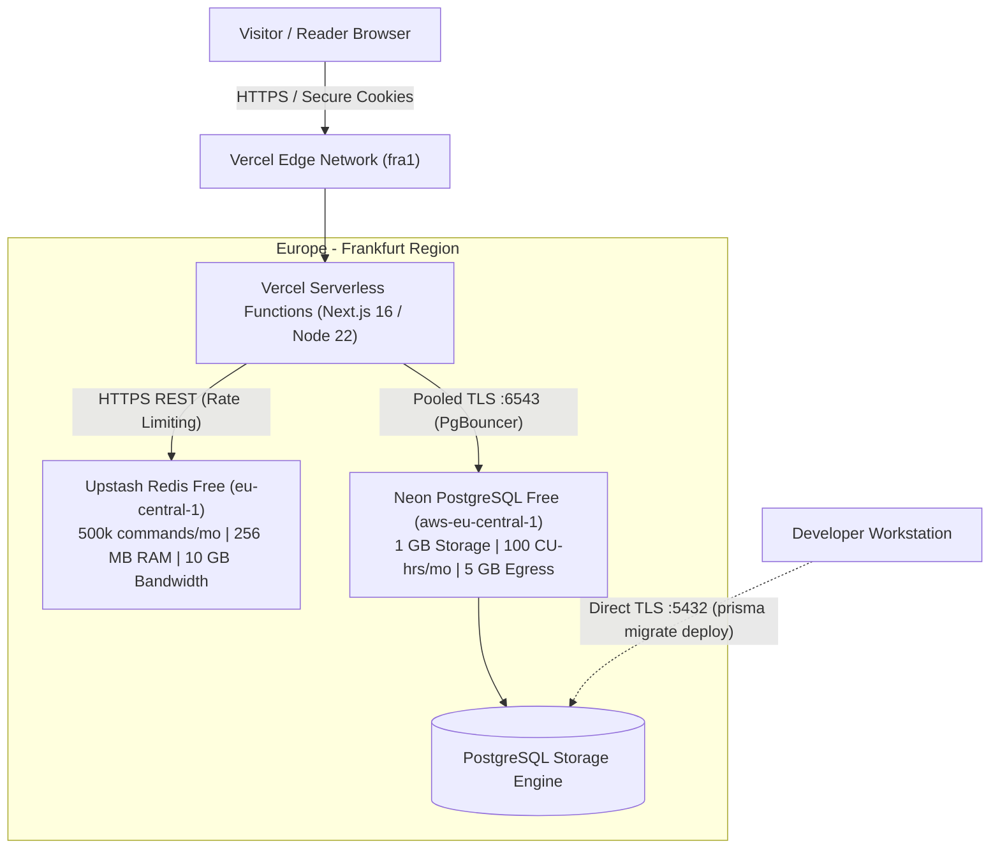

# UNSENT — Strict $0 Free-Tier Production Deployment Guide

**Approved Production Architecture:** Vercel Hobby + Neon Serverless PostgreSQL Free + Upstash Redis Free  
**Deployment Cost:** Exactly **$0.00** — No credit cards, no paid upgrades, no usage-based billing, no surprise fees.  
**Target Region:** Frankfurt (`fra1` / `eu-central-1`)  
**Runtime:** Native Next.js 16 Serverless on Vercel Node.js 22 LTS (Amazon Linux 2023)  
**Security Standard:** Zero-Trust, Encrypted Identifiers, Native Argon2id, Ephemeral Anonymous Sessions, Fail-Closed Distributed Rate Limiting.

---

> [!IMPORTANT]
> **Strict Non-Commercial License Requirement (Vercel Hobby):**  
> Vercel's Hobby plan is legally restricted to **personal, educational, and non-commercial projects**. UNSENT is designed and deployed under this tier strictly as a free, public literary sanctuary. Commercial monetization, paid subscriptions, commercial sponsorships, or business use are strictly prohibited under the Vercel Hobby Terms of Service unless formally migrated to a paid plan.

---

## 1. Architectural Overview & Free-Tier Limits

To guarantee that UNSENT operates permanently without incurring any financial charges, all infrastructure is strictly mapped to genuinely free tiers that do not require credit card entry or permit automatic paid overages.



### Free-Tier Capacity Matrix

| Component | Provider & Plan | Cost | Hard Quota & Service Limits | Over-Quota Behavior |
| :--- | :--- | :--- | :--- | :--- |
| **Web & API Hosting** | **Vercel Hobby** | $0 / mo | • **1,000,000 (1M)** Serverless Function Invocations / mo<br>• **100 GB** Fast Data Transfer / mo<br>• **1024 MB** RAM per function<br>• **10s** default timeout (max 60s)<br>• **Strictly personal / non-commercial use only** | Requests throttled or HTTP 402/503 returned. Invocations pause until monthly cycle reset. Usage limits cannot be bypassed by charging; never automatically upgrades or charges overages. Traffic availability is not guaranteed once limits are exhausted. |
| **Database** | **Neon Free Tier** | $0 / mo | • **1.0 GB** PostgreSQL data storage per project<br>• **100 Compute Unit (CU) hours** / mo per project<br>• **5 GB** monthly public network transfer (egress)<br>• **1 project**, up to 10 branches<br>• **6-hour** instant restore history (PITR)<br>• **Scale-to-zero** after 5 min idle | • **Storage (1 GB exceeded):** Neon rejects writes (`INSERT`, `UPDATE`, `CREATE TABLE`) with a storage limit/disk full error; existing data remains readable.<br>• **Compute (100 CU-hrs exhausted):** Compute endpoint is suspended until next monthly billing cycle; connections fail (HTTP 500/503).<br>• **Bandwidth (5 GB exceeded):** Network egress is throttled or suspended. |
| **Rate Limiter** | **Upstash Redis Free** | $0 / mo | • **500,000** commands / month (no daily cap)<br>• **256 MB** maximum database size<br>• **10 GB** monthly bandwidth<br>• **1 free database**<br>• Max 1000 concurrent connections | Commands rejected with `ERR max monthly request limit exceeded...`. UNSENT catches the error and **fails closed** (returns HTTP 503 `SERVICE_UNAVAILABLE`). Protected operations (submit, login, register, report) are refused to prevent abuse. No overage charges. Quota resets on the 1st of the next calendar month. |
| **Domain** | **Vercel Subdomain** | $0 / mo | • Included `*.vercel.app` domain with automated SSL / TLS termination | N/A — Free and permanent. |

---

## 2. Compatibility Audit & Architectural Verification

The codebase has been verified for compatibility with Vercel serverless execution:

1. **Next.js & Standalone Output:**
   - On Vercel, Next.js natively builds and packages serverless function lambdas and edge assets.
   - [`next.config.ts`](file:///C:/Users/hp/.gemini/antigravity/scratch/unsent/next.config.ts) was updated so that `output: "standalone"` is only activated if `BUILD_STANDALONE="true"` is set for custom Docker builds, allowing native Vercel serverless packaging without conflict.
2. **Prisma Client Generation:**
   - [`package.json`](file:///C:/Users/hp/.gemini/antigravity/scratch/unsent/package.json) contains `"postinstall": "prisma generate"`. During Vercel's automated install phase, `@prisma/client` is automatically compiled and pinned to the serverless function layer.
3. **Native Argon2id Password Hashing & Runtime Verification:**
   - Package: `argon2` v0.45.2.
   - Vercel functions execute on **Node.js 22 LTS inside Amazon Linux 2023 (`x86_64` with glibc 2.34)**.
   - *Verification Constraint:* Local Windows builds confirm TypeScript, bundler, and syntax compatibility, but **do not verify native C++ addon execution inside Vercel's Linux container**.
   - Before opening registration to public users, native Argon2 hash and verify execution must be explicitly confirmed via a live test registration on the deployed Vercel URL (see [Section 7](#7-verifying-the-live-deployment)).
   - Memory parameters (`m=65536` [64 MB], `t=3`, `p=4`) consume only ~6.25% of Vercel's 1024 MB function RAM.
   - The semaphore in [`src/lib/auth/password.ts`](file:///C:/Users/hp/.gemini/antigravity/scratch/unsent/src/lib/auth/password.ts) bounds concurrency to 2 simultaneous operations with a queue of 10, preventing CPU context thrashing.
4. **Session Cookies Behind Vercel Edge Proxy:**
   - Vercel automatically terminates TLS at the edge. The application uses `cookies()` with `httpOnly: true, secure: true, sameSite: "lax", path: "/"`. Sessions remain persistent and secure over `https://*.vercel.app`.
5. **Stateless Operation (Zero Local Filesystem Dependency):**
   - No user content, letters, notes, or sessions are written to the local disk. Everything is persisted in PostgreSQL or Upstash Redis. Archive JSON export is generated in-memory and streamed directly over HTTP.
6. **Neon Scale-to-Zero & Cold Starts:**
   - In Neon Free, compute instances pause after 5 minutes of inactivity. When a new visitor accesses the app, Neon wakes up with a cold-start delay (typically 500ms to 2000ms). Prisma Client automatically waits for the TCP socket and resumes operations.
7. **Distributed Rate Limiter Across Multiple Serverless Instances:**
   - Rate limiting state is hosted centrally in Upstash Redis (Frankfurt) via HTTPS REST calls.
   - All serverless function instances share the exact same distributed sliding-window counter in Redis, preventing in-memory counter drift or synchronization issues across ephemeral serverless containers.
   - [`src/lib/rate-limit.ts`](file:///C:/Users/hp/.gemini/antigravity/scratch/unsent/src/lib/rate-limit.ts) enforces strict fail-closed behavior in production: if Upstash is unreachable or quota exhausted, protected operations return HTTP 503 (`SERVICE_UNAVAILABLE`).

---

## 3. Step-by-Step Setup Instructions ($0 Cost)

### Step 1: Provision Neon PostgreSQL Free
1. Sign up at [neon.tech](https://neon.tech/) using GitHub or Google (no credit card required).
2. Create project `unsent-prod` in region `Europe (Frankfurt) / aws-eu-central-1`.
3. Obtain connection strings:
   - Pooled connection (`port 6543`, `?sslmode=require&pgbouncer=true`): Set as `DATABASE_URL`.
   - Direct connection (`port 5432`, `?sslmode=require`): Set as `DIRECT_URL`.

### Step 2: Provision Upstash Redis Free
1. Sign up at [upstash.com](https://upstash.com/) using GitHub or Google (no credit card required).
2. Create regional database in `eu-central-1 (Frankfurt)` on the Free plan ($0).
3. Copy `UPSTASH_REDIS_REST_URL` and `UPSTASH_REDIS_REST_TOKEN`.

### Step 3: Configure Vercel Project
1. Sign up or log in at [vercel.com](https://vercel.com/) with GitHub.
2. Click **Add New... > Project** and import repository `saidmukhammedov/unsent`.
3. In **Project Settings**:
   - **Framework Preset:** Next.js
   - **Root Directory:** `./`
   - **Build Command:** `pnpm build` (default)
   - **Install Command:** `pnpm install` (default)
4. Set **Physical Serverless Function Region:**
   - In **Project Settings > Functions > Function Regions**, select **Frankfurt, Germany (`fra1`)**.
   - > [!IMPORTANT]
     > The physical execution region is configured in the Vercel dashboard under **Project Settings > Functions**. Setting the environment variable `VERCEL_REGION=fra1` does **NOT** configure function placement; it is purely an informational diagnostic label read by the application for `/api/health`.

---

## 4. Production Environment Variables & Environment Separation

> [!CAUTION]
> **STRICT ENVIRONMENT SEPARATION (PRODUCTION ONLY):**  
> All production database connection strings (`DATABASE_URL`, `DIRECT_URL`) and production secrets (`SESSION_SECRET`, `RATE_LIMIT_LOG_SECRET`, `MODERATOR_TOKEN`, `UPSTASH_*`) must be configured for **Production ONLY** in the Vercel dashboard.  
> - **Uncheck "Preview" and "Development"** when adding these variables to Vercel.  
> - Preview deployments must **NOT** access the production Neon database or production Upstash Redis instance.  
> - Do not use Preview deployments for testing until separate, isolated staging infrastructure (e.g. a separate Neon branch and staging Redis) is provisioned.

In **Vercel Project Settings > Environment Variables**, configure the following variables for **Production**:

| Variable Name | Environment Scope | Value / Source Instructions |
| :--- | :--- | :--- |
| `NODE_ENV` | **Production only** | `production` (Automatically set by Vercel for Production builds) |
| `NEXT_PUBLIC_APP_URL` | **Production only** | `https://<your-project-subdomain>.vercel.app` |
| `VERCEL_REGION` | **Production only** | `fra1` (Diagnostic label for `/api/health`) |
| `DATABASE_URL` | **Production only** | Pooled Neon connection string (`...-pooler...:6543/neondb?sslmode=require`) |
| `DIRECT_URL` | **Production only** | Direct unpooled Neon connection string (`...:5432/neondb?sslmode=require`) |
| `SESSION_SECRET` | **Production only** | 64-char random hex string (Generate via PowerShell Step 1 below) |
| `RATE_LIMIT_LOG_SECRET` | **Production only** | 64-char random hex string — Dedicated HMAC-SHA256 salt (Generate via PowerShell Step 2 below) |
| `MODERATOR_TOKEN` | **Production only** | 64-char random hex string — Server-side secret for administrative tools (Generate via PowerShell Step 3 below) |
| `MODERATOR_UNSENT_IDS` | **Production only** | Leave empty initially (`""`). Populate after registering the first steward account. |
| `UPSTASH_REDIS_REST_URL` | **Production only** | Upstash REST URL (`https://deciding-marlin-194640.upstash.io`) |
| `UPSTASH_REDIS_REST_TOKEN`| **Production only** | Upstash REST Token |

### Safe Sequential Secret Generation Instructions

> [!WARNING]
> **Sequential Generation Warning:**  
> The PowerShell commands below pipe directly to your clipboard. Because each command overwrites the clipboard, **run and paste each command one at a time**:

1. **Generate `SESSION_SECRET`:**
   ```powershell
   $b = New-Object byte[] 32; [Security.Cryptography.RandomNumberGenerator]::Create().GetBytes($b); ([BitConverter]::ToString($b) -replace '-').ToLower() | Set-Clipboard
   ```
   *Action:* Paste into Vercel Environment Variables dashboard as `SESSION_SECRET` for **Production only** and click Save.

2. **Generate `RATE_LIMIT_LOG_SECRET`:**
   ```powershell
   $b = New-Object byte[] 32; [Security.Cryptography.RandomNumberGenerator]::Create().GetBytes($b); ([BitConverter]::ToString($b) -replace '-').ToLower() | Set-Clipboard
   ```
   *Action:* Paste into Vercel Environment Variables dashboard as `RATE_LIMIT_LOG_SECRET` for **Production only** and click Save. *(Must NOT be identical to `SESSION_SECRET`)*.

3. **Generate `MODERATOR_TOKEN`:**
   ```powershell
   $b = New-Object byte[] 32; [Security.Cryptography.RandomNumberGenerator]::Create().GetBytes($b); ([BitConverter]::ToString($b) -replace '-').ToLower() | Set-Clipboard
   ```
   *Action:* Paste into Vercel Environment Variables dashboard as `MODERATOR_TOKEN` for **Production only** and click Save.

---

## 5. Database Migration Safety & Deployment

The production database on Neon (`plain-fire-46935664`, branch `production`) has already applied migration `0_init`.

> [!CAUTION]
> **Database Safety Invariants:**
> - **Never run `pnpm prisma db push` against production.**
> - **Never run `pnpm prisma migrate reset` against production.**
> - The Vercel build command is strictly `pnpm build`, which only generates the Prisma client. It does **NOT** run database migrations.
> - If future migrations are created, review every SQL statement, take a manual `pg_dump` snapshot, and execute `pnpm prisma migrate deploy` locally against Neon `DIRECT_URL` before deploying application code.

---

## 6. Provisioning the First Moderator Account (Mandatory Precondition)

> [!CRITICAL]
> **MANDATORY PRECONDITION BEFORE PUBLIC ORBIT SUBMISSIONS:**  
> First-admin registration and role promotion is an **explicit, mandatory prerequisite** before accepting public Orbit letter submissions or publicizing the service. Unrestricted public submissions must not be accepted until moderation and reporting workflows have been verified operational with a real steward account.

### Secure Moderator Provisioning Procedure:

1. **Register a Standard Account via the Live Application:**
   - Visit the production site (`https://<your-project>.vercel.app`).
   - Create a session (anonymous visit).
   - Navigate to `/register` and register an account using a real phone number and strong password.
   - Note the assigned permanent `unsentId` displayed in your Sanctuary (e.g. `@steward_alex_9f3b`).

2. **Grant Moderator Privileges via Neon Console:**
   - Connect to Neon PostgreSQL via Neon Console SQL Editor using `DIRECT_URL`:
     ```sql
     UPDATE users
     SET role = 'ADMIN'
     WHERE unsent_id = '@steward_alex_9f3b';
     ```
   - Verify role promotion:
     ```sql
     SELECT id, unsent_id, role, account_type FROM users WHERE unsent_id = '@steward_alex_9f3b';
     ```

3. **Verify Moderation Dashboard:**
   - Log in to `https://<your-project>.vercel.app` with the promoted account.
   - Access `/moderation` and verify that the stewardship dashboard loads.
   - Test reporting and moderation workflows (dismiss, remove) on a test letter.
   - Only after this verification gate passes should public Orbit submissions be enabled.

---

## 7. Verifying the Live Deployment

Once Vercel finishes deploying to `https://<your-project>.vercel.app`:

1. **Verify Health Endpoint & Measure Real-World Latency:**
   ```bash
   curl -i https://<your-project>.vercel.app/api/health
   ```
   *Expected Response:* `HTTP/2 200 OK` with JSON body:
   ```json
   {
     "status": "healthy",
     "timestamp": "2026-11-07T...",
     "region": "fra1",
     "uptimeSeconds": 1,
     "checks": {
       "database": "connected",
       "rateLimiter": {
         "backend": "redis",
         "configured": true,
         "reachable": true
       }
     },
     "latencyMs": 42
   }
   ```
   > [!NOTE]
   > **Latency Verification:** Real-world network and compute latency between Vercel Serverless (`fra1`), Neon, and Upstash is unverified until measured on the live service via the `latencyMs` field.

2. **Verify Native Argon2 Execution on Vercel Runtime:**
   - Navigate to `/register` on the live Vercel domain.
   - Complete a registration with a test phone number and password.
   - Confirm that the request succeeds (HTTP 200), that session cookies are set, and that no native binary load errors occur in Vercel function runtime logs.

3. **Verify Ephemeral Anonymous Session:**
   - Visit `https://<your-project>.vercel.app` in an incognito window.
   - Open browser Developer Tools > Application > Cookies.
   - Confirm `unsent_session` cookie is present with `HttpOnly`, `Secure`, and `SameSite=Lax`.

4. **Verify Moderator Access & Precondition Gate:**
   - Follow Section 6 to register and promote the first steward account.
   - Verify `/moderation` access and workflow operations.

---

## 8. Quota Exhaustion Behaviors & Resilience

| Service | Quota / Limit | Exact Quota Exhaustion Behavior & System Impact |
| :--- | :--- | :--- |
| **Upstash Redis** | 500,000 commands / month | Upstash REST API returns `ERR max monthly request limit exceeded...`. The UNSENT rate limiter logs `[CRITICAL_RATE_LIMITER_FAILURE]` and **fails closed** (`status: "service_unavailable"`, error: `"SERVICE_UNAVAILABLE"`). Protected operations (submit, login, register, report) return **HTTP 503**. Public unprotected reads continue serving. No charges are incurred. Resets on the 1st of the next month. |
| **Neon Compute** | 100 CU-hours / month | Neon suspends the project compute endpoint until the first day of the next calendar month. All database queries fail with connection timeout or connection refused errors. API routes dependent on the database return HTTP 500/503. Static assets continue serving from Vercel Edge. |
| **Neon Storage** | 1.0 GB data storage | Neon rejects write operations (`INSERT`, `UPDATE`, `CREATE TABLE`) with a storage full error. Existing letters and Orbit posts remain readable. |
| **Neon Bandwidth** | 5 GB egress / month | Egress bandwidth is throttled or suspended until the monthly cycle resets. |
| **Vercel Hobby** | 1,000,000 invocations / mo<br>100 GB Fast Data Transfer | Vercel throttles traffic or returns HTTP 402/503, pausing serverless function execution until the next monthly billing cycle. Hobby accounts cannot incur automatic paid overages. UNSENT does not promise continuous traffic availability if free limits are exhausted. |

---

## 9. Backup & Disaster Recovery Limitations on Free Tier

1. **Neon Free Point-in-Time Recovery (PITR):**
   - Free-tier Neon projects retain **6 hours** of continuous point-in-time recovery history (unlike paid plans which retain 30 days).
   - If an accidental schema change or data corruption occurs, recovery must be initiated within 6 hours via the Neon Console.
   - **Mandatory Practice:** Before applying any schema migration, export an explicit snapshot using `pg_dump`:
     ```bash
     pg_dump -d "$DIRECT_URL" -F c -b -v -f "unsent_backup_$(date +%Y%m%d_%H%M%S).dump"
     ```
2. **Upstash Redis Persistence:**
   - Free-tier databases are ephemeral and do not include automated daily cloud snapshot exports.
   - Because UNSENT uses Redis strictly for sliding-window rate limit counters and key correlation cache, losing Redis data does not destroy user identities, letters, or notifications. Rate counters simply start fresh.
